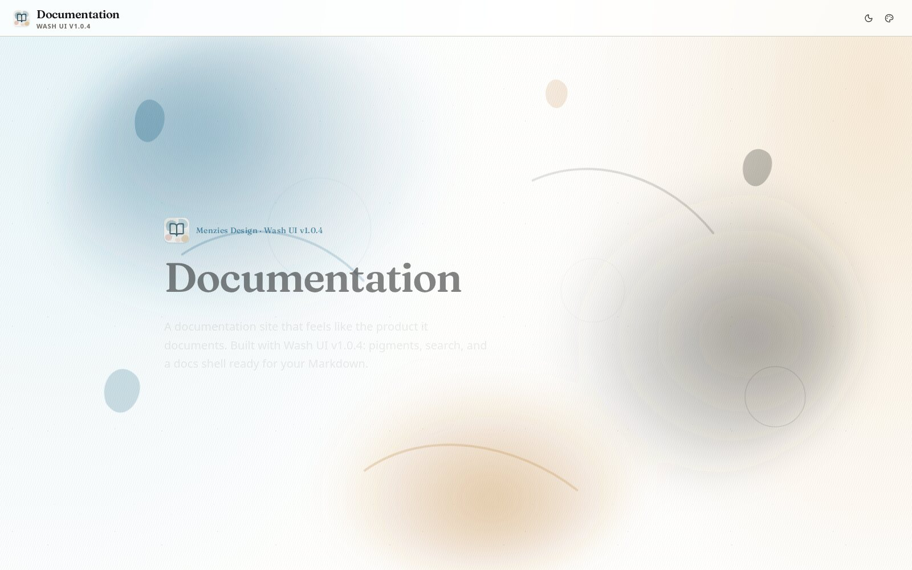
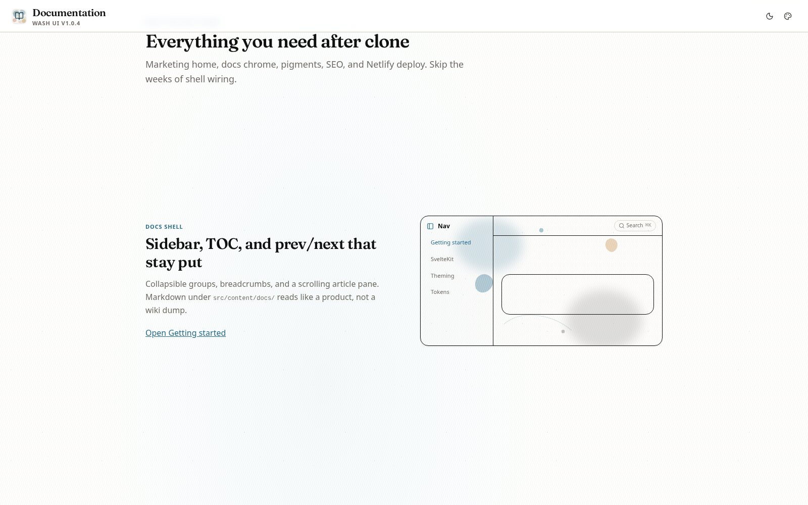
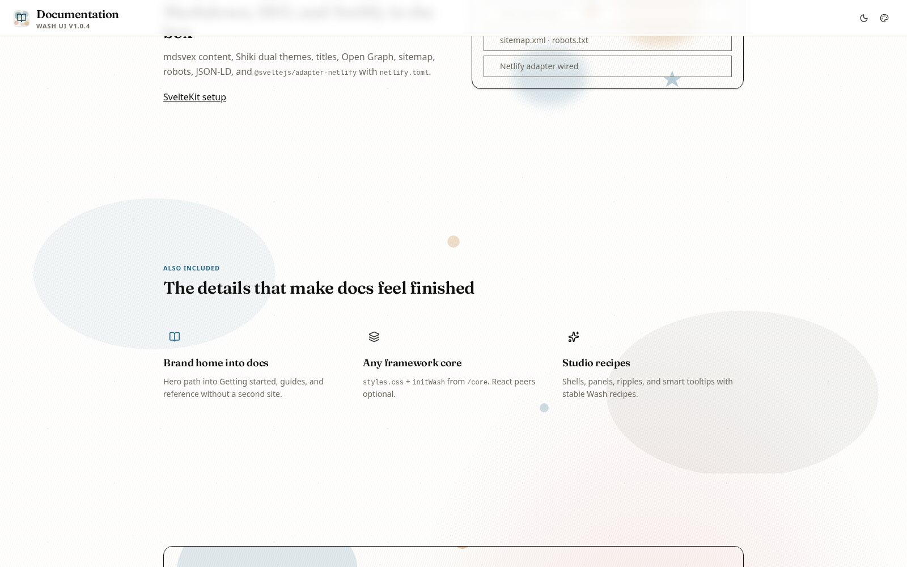
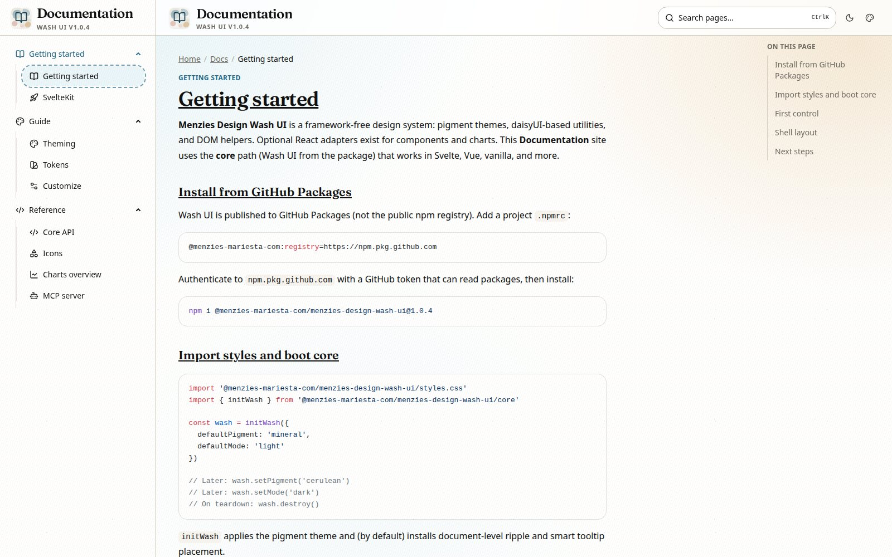
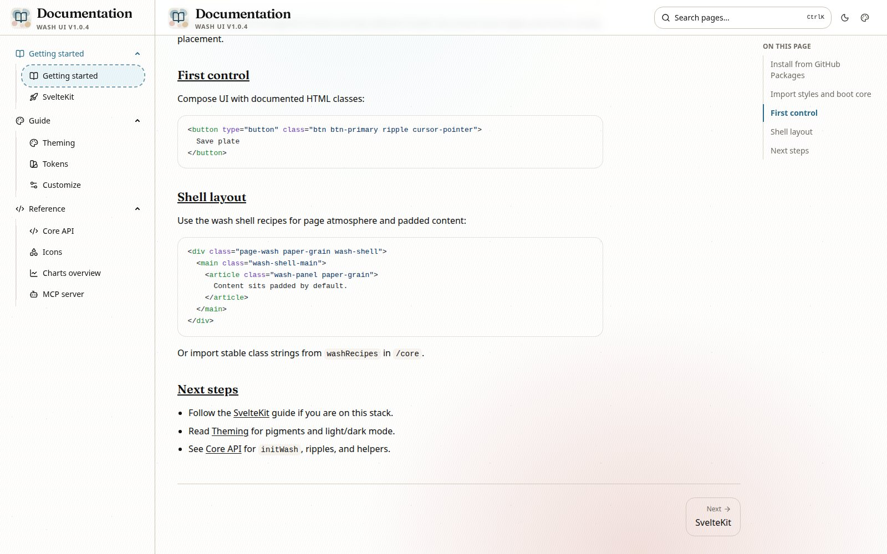
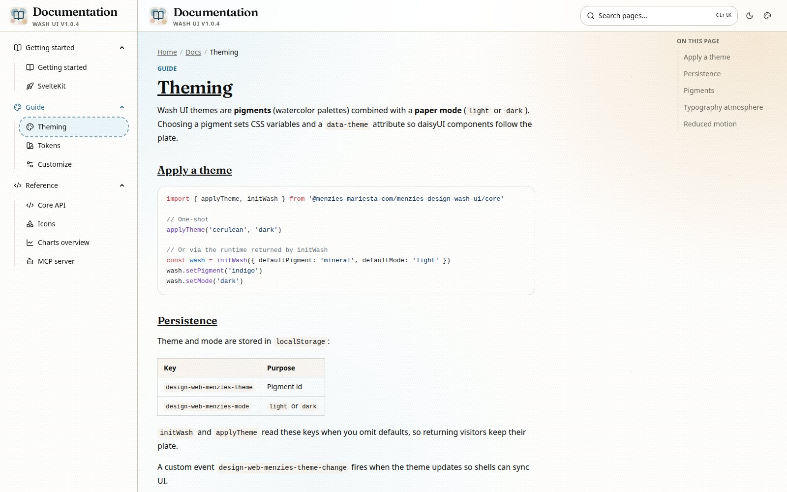

# Documentation

A ready-to-ship **Documentation** site template powered by [Menzies Design Wash UI](https://design-menzies.netlify.app/): marketing home, Markdown docs, Cmd+K search, pigment themes, and Netlify deploy. Clone it, drop in your pages, ship.

<p align="center">
  
</p>

<p align="center">
  <a href="https://github.com/menzies-mariesta-com/documentation-web-template-menzies"></a>
  
  
  
  
  
</p>

<p align="center">
  <a href="#quick-start"><strong>Quick start</strong></a>
  ·
  <a href="#what-you-get"><strong>What you get</strong></a>
  ·
  <a href="#docs-shell"><strong>Docs shell</strong></a>
  ·
  <a href="#customize"><strong>Customize</strong></a>
</p>

---

## Why clone this instead of starting from scratch?

Blank SvelteKit + Markdown leaves you wiring sidebar, search, themes, SEO, and deploy yourself. This template already does that, styled with **Wash UI pigments** so your docs look like the design system they document.

| Pain | This template |
|------|----------------|
| Docs feel like a wiki dump | Brand home → **Get started** → structured guides |
| Search is an afterthought | `Ctrl` / `⌘` `K` over every page |
| Theme toggle is bolted on | Light/dark + **30 Wash pigments** in the chrome |
| Code blocks look plain | Shiki dual themes + one-click copy |
| SEO and deploy later | Titles, OG, sitemap, robots, Netlify adapter |

---

## What you get

<p align="center">
  
</p>

- **Marketing home** with splash motion, feature sections, and a clear path into docs
- **Docs shell**: collapsible sidebar, breadcrumbs, TOC, prev/next
- **On this page** TOC on large screens (`xl` and up), with active section highlight
- **Command search** (`Ctrl` / `⌘` `K`)
- **Theme chrome**: paper mode + pigment picker
- **Markdown** under `src/content/docs/` (mdsvex + Shiki)
- **SEO baseline**: meta, Open Graph / Twitter, sitemap, robots, JSON-LD
- **Netlify-ready**: `@sveltejs/adapter-netlify` + `netlify.toml`

<p align="center">
  
</p>

---

## Docs shell

Captured at **1600×1000** so the full desktop layout is visible: left nav, article, and the right-hand **On this page** rail (that rail is hidden below the `xl` breakpoint).

<p align="center">
  
</p>

<p align="center">
  
</p>

<p align="center">
  
</p>

**Responsive note:** the **On this page** column only mounts from the `xl` breakpoint upward. Narrower viewports keep the article full width; do not screenshot docs UX below `xl` if you need the TOC in the frame.

---

## Quick start

```bash
git clone git@github.com:menzies-mariesta-com/documentation-web-template-menzies.git
cd documentation-web-template-menzies
npm install
npm run dev
```

Open [http://localhost:5173](http://localhost:5173).

### Wash UI from GitHub Packages

Depends on `@menzies-mariesta-com/menzies-design-wash-ui@1.0.4`. Project `.npmrc` already scopes the package to GitHub Packages. Authenticate once:

```bash
# ~/.npmrc (or CI secret)
//npm.pkg.github.com/:_authToken=YOUR_GITHUB_TOKEN
```

Token needs `read:packages` for the org.

---

## Stack

| Layer | Choice |
|-------|--------|
| App | SvelteKit 2 + Svelte 5 (runes) |
| UI | Wash UI `styles.css` + Tailwind CSS 4 |
| Core | `initWash` from `/core` (no React peers) |
| Docs | mdsvex + Shiki (light/dark) |
| Icons | `@lucide/svelte@1.28.0` |
| Motion | GSAP + ScrollTrigger on the home page |
| Deploy | `@sveltejs/adapter-netlify` |

Optional scaffolds (Paraglide, Better Auth, Drizzle) ship with the repo but are unused by the public docs surface.

---

## Project map

```text
src/
  content/docs/          # Markdown (frontmatter: title, description, section, order)
  lib/components/docs/   # Sidebar, search, TOC, header, theme switcher, brand mark
  lib/components/home/   # Landing sections, wash splash, feature ink
  lib/tool/docs/         # Nav tree, search index, TOC helpers
  lib/assets/            # favicon.svg + app-icon.svg (BookOpen on mineral wash)
  routes/(public)/
    +page.svelte         # Home
    docs/                # Docs layout + [...slug]
```

**Add a page:** create a `.md` file in `src/content/docs/` with frontmatter. It shows up in the sidebar automatically (HMR or restart if needed).

---

## Customize

1. Home copy and motion: `src/lib/components/home/`
2. Docs content: `src/content/docs/`
3. Site URL: `PUBLIC_SITE_URL` (see `.env.example` / `netlify.toml`)
4. Social image: `static/og-default.png`
5. Brand mark: `src/lib/assets/favicon.svg` / `app-icon.svg`
6. Package version: bump Wash UI when you publish a new release

---

## Scripts

| Command | Purpose |
|---------|---------|
| `npm run dev` | Local development |
| `npm run build` | Production build |
| `npm run preview` | Preview the build |
| `npm run check` | `svelte-check` |
| `npm run test:e2e` | Playwright smoke tests |

---

## Related

- Live Wash UI gallery: [design-menzies.netlify.app](https://design-menzies.netlify.app/)
- Design system package: `@menzies-mariesta-com/menzies-design-wash-ui`
- Monorepo: [design-lib-menzies](https://github.com/menzies-mariesta-com/design-lib-menzies)

---

## License

Wash UI is `GPL-3.0-or-later`. Use this template as a starting point for Menzies / MARIESTA documentation sites; follow your deployment target’s license for published content.
