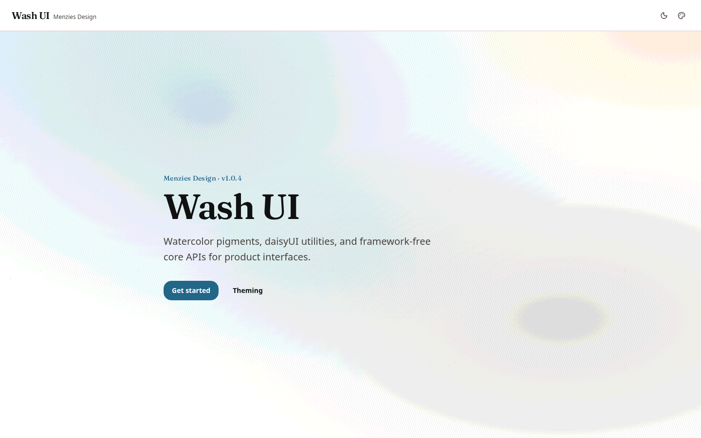
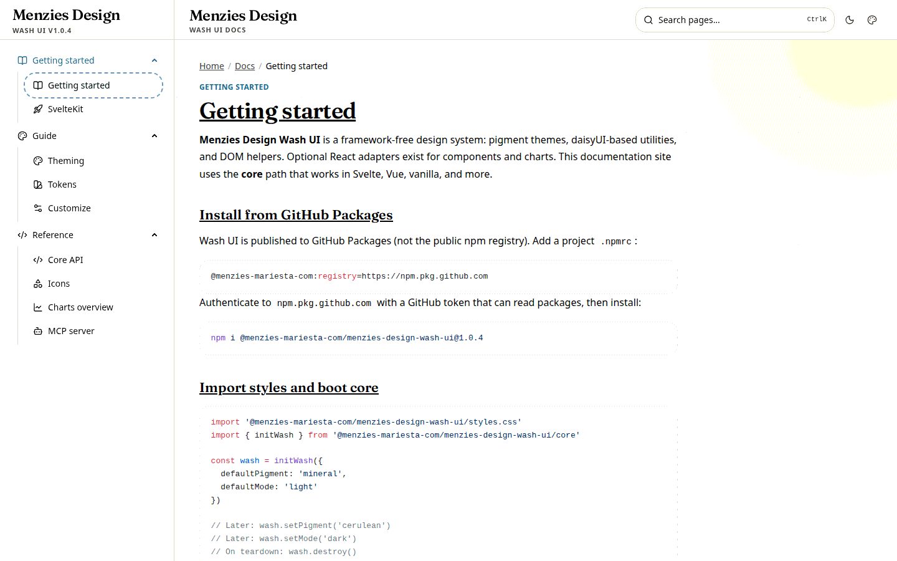
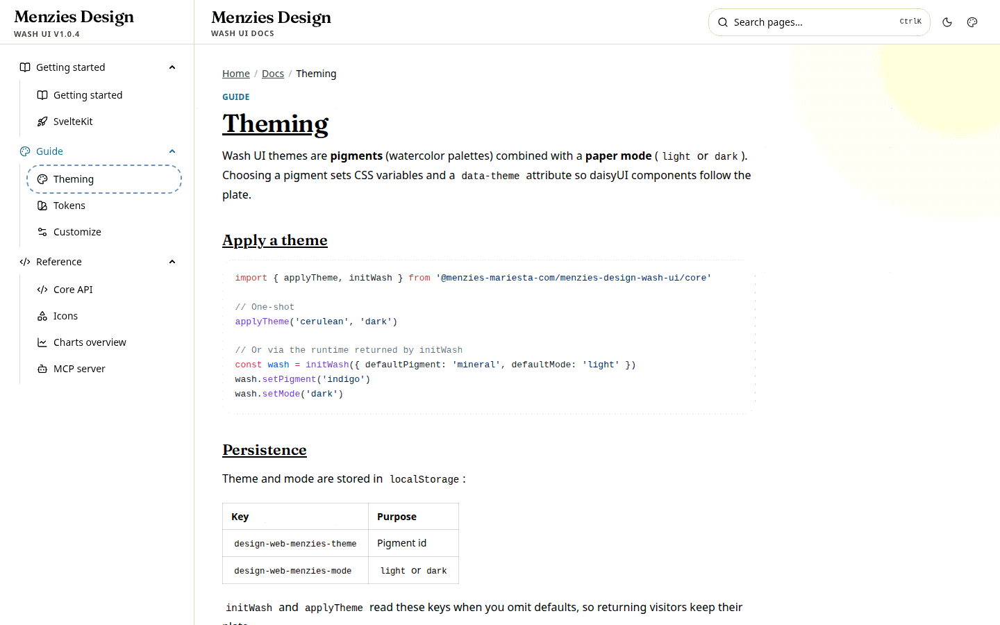

# Documentation Web Template · Menzies

Ship a polished **Wash UI** documentation site in minutes: marketing home, Get started flow, Cmd+K search, pigment themes, and Markdown docs on SvelteKit.

<p align="center">
  
</p>

<p align="center">
  <a href="https://github.com/menzies-mariesta-com/documentation-web-template-menzies"></a>
  
  
  
  
</p>

---

## Why this template

Most docs starters give you a blank Markdown tree. This one gives you a **product-ready docs experience** already themed with [Menzies Design Wash UI](https://design-menzies.netlify.app/):

| You get | Details |
|--------|---------|
| Marketing home | Brand-first hero + **Get started** CTA into docs |
| Docs shell | Collapsible sidebar, breadcrumbs, TOC, prev/next |
| Command search | `Ctrl/⌘K` palette over every page |
| Pigment themes | Light/dark + 30 Wash UI pigments |
| Markdown pipeline | mdsvex + Shiki highlighting + copy buttons |
| SEO baseline | Titles, OG/Twitter, sitemap, robots, JSON-LD |
| Netlify-ready | Adapter + `netlify.toml` included |

<p align="center">
  
</p>

---

## Quick start

```bash
git clone git@github.com:menzies-mariesta-com/documentation-web-template-menzies.git
cd documentation-web-template-menzies
npm install
npm run dev
```

Open [http://localhost:5173](http://localhost:5173).

### Wash UI from GitHub Packages

This project uses `@menzies-mariesta-com/menzies-design-wash-ui@1.0.4`. Project `.npmrc` already points the scope at GitHub Packages. Authenticate once:

```bash
# ~/.npmrc (or CI secret)
//npm.pkg.github.com/:_authToken=YOUR_GITHUB_TOKEN
```

Token needs `read:packages` for the org.

---

## Stack

- **SvelteKit 2** + Svelte 5 (runes)
- **Tailwind CSS 4** + Wash UI `styles.css` (daisyUI tokens included)
- **`initWash`** from `/core` (no React peers required)
- **mdsvex** for docs content under `src/content/docs/`
- **Shiki** for dual light/dark code blocks
- **Lucide** `@lucide/svelte@1.28.0`
- **Paraglide**, Better Auth + Drizzle scaffolds (optional; unused by public docs)
- **`@sveltejs/adapter-netlify`**

---

## Project map

```text
src/
  content/docs/          # Markdown pages (frontmatter: title, description, section, order)
  lib/components/docs/   # Sidebar, search, TOC, header, theme switcher
  lib/tool/docs/         # Nav tree, search index, highlighting helpers
  routes/(public)/
    +page.svelte         # Home
    docs/                # Docs layout + [...slug] pages
```

Add a page: drop a `.md` file in `src/content/docs/` with frontmatter, then restart or let HMR pick it up. It appears in the sidebar automatically.

---

## Docs UX highlights

<p align="center">
  
</p>

- **Sidebar groups** with daisyUI `menu` + `details` (Getting started, Guide, Reference)
- **`menu-wash-active`** selection matching the live Wash UI gallery
- **Aligned chrome** on large screens: sidebar brand bar and main header share `app-chrome-bar` height
- **Smooth scroll** for TOC anchors (respects `prefers-reduced-motion`)
- **SEO helpers** in `src/lib/util/seo.ts`

---

## Scripts

| Command | Purpose |
|---------|---------|
| `npm run dev` | Local development |
| `npm run build` | Production build (Netlify) |
| `npm run preview` | Preview the build |
| `npm run check` | `svelte-check` |
| `npm run test:e2e` | Playwright smoke tests |

---

## Customize for your product

1. Replace home copy in `src/routes/(public)/+page.svelte`
2. Rewrite or add Markdown under `src/content/docs/`
3. Set `PUBLIC_SITE_URL` (see `.env.example` / `netlify.toml`)
4. Swap OG image at `static/og-default.png`
5. Point package consumers at your own Wash UI version when you publish

---

## Related

- Live Wash UI gallery: [design-menzies.netlify.app](https://design-menzies.netlify.app/)
- Design system package: `@menzies-mariesta-com/menzies-design-wash-ui`
- Monorepo: [design-lib-menzies](https://github.com/menzies-mariesta-com/design-lib-menzies)

---

## License

Follow the license of your deployment target and Wash UI (`GPL-3.0-or-later` for the design system package). This template repo: use as a starting point for Menzies / MARIESTA documentation sites.
